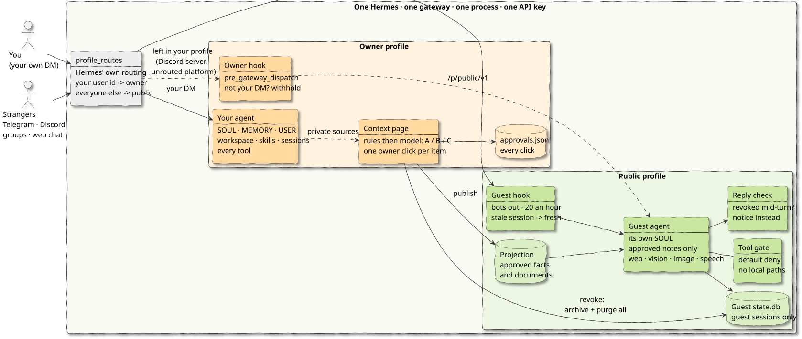
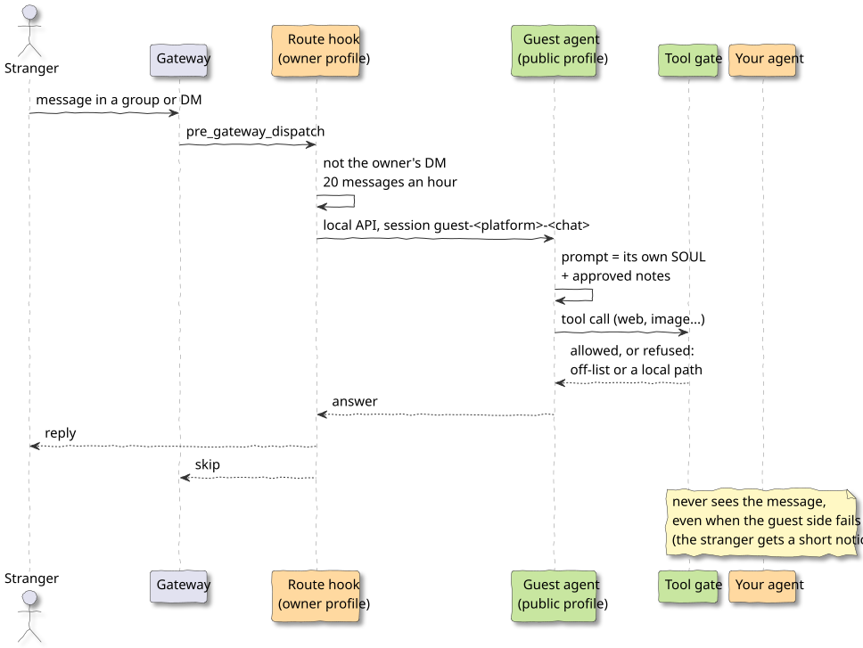

# Salt's Secrets

> What if the Hermes you've spent thousands of hours growing with could talk to everyone, without giving away a single secret?

### Identity-based context isolation for Hermes Agent. One Hermes, two minds.

[](https://github.com/dotv-7/salts-secrets-plugin/actions/workflows/tests.yml)

**The story (a fictional demo, every detail invented).** Lena Moreau is an anonymous crypto KOL. Online
she is only **Salt**: [@saltwater_sats](https://salt.dotv.io), 310k followers on X, the account that called out
Harbor Finance's reserves three weeks before it collapsed, and author of Low Tide, a paid newsletter on stablecoin
reserves, bridges and exchange risk. For two years she has been training her Hermes: every issue she wrote, her
four bridge checks, her exchange net-outflow signal, the calls she got wrong and why. It now analyses the way she
does, and her followers want to talk to it: check a bridge, read a wallet, ask why she made a call.

The same Hermes knows her real name and her flat in Lisbon, her hot wallet and what she holds, an unpublished call
on Lantern v2, the day her father died, and the password to her router, because she told it. Today she has two
choices: keep her twin private and her followers get nothing, or share it and every one of those facts is one
question away for anyone on Telegram, Discord or the web. For an anonymous KOL that is doxxing, front-running
and harassment waiting to happen.

What actually goes wrong when you share an agent that knows you:

- **One question doxxes you.** "Which city does Salt live in?" Her Hermes knows the street. For an anonymous
  KOL the handle is the safety, and a guessing game ("is it Lisbon?") leaks as much as an answer.
- **Your book gets front-run.** Her holdings, her hot wallet and an unpublished call on Lantern v2 are in memory.
  One leak moves a market against her, or against the followers who trade on her calls.
- **Your family becomes content.** Her father's death anniversary, her mother's medication, a letter to her
  estranged sister: all in the workspace her agent reads.
- **Credentials are one tool call away.** Router password, where the recovery kit lives, API keys. An agent with
  `read_file` and a terminal can be talked into opening them.
- **"Never share this" is not a boundary.** A prompt rule can be argued with, role-played around or forgotten in a
  long chat. A model that never had the fact cannot leak it.
- **Unpublishing is not forgetting.** Take something back and it still lives in old guest transcripts and summaries.
- **Copying by hand kills the twin.** Building a second bot means rewriting hundreds of notes and keeping them in
  sync, and it loses the skills that made the first one worth talking to.

Salt's Secrets is the third choice. Strangers talk to **Salt's twin**: her methods, her published work, her voice,
able to run her bridge checks on a protocol you name. Lena's life never enters that room. Every item she shares
crosses with one click from her, often as a rewrite; everything else stays on her side, unreachable by any tool,
and taking something back purges the guest transcripts that saw it. Try it at
**[salt.dotv.io](https://salt.dotv.io)**; the read-only passphrase `lena-readonly` shows Lena's side of the same
conversation. The same goes for any expert whose Hermes got good: a researcher, a consultant, a developer.

This project gives Hermes a second mind. Strangers never reach your agent. They reach a **public profile**
that is built from nothing but what you ticked as public, rewritten in a guest-safe voice, and that
cannot reach your files, your sessions or your memory even if it wanted to. You keep one Hermes,
one gateway, one API key. Only the context is split, and it is split by **who is asking**.

| | Your session | The session strangers reach |
|---|---|---|
| SOUL.md | yours | its own, written for strangers |
| MEMORY.md / USER.md | injected every turn | switched off; only ticked lines arrive, as rewritten facts |
| Workspace, private/, skills | readable with read_file | no read_file, no path leads there |
| Sessions | session_search over everything | its own state.db, holding only guest conversations |
| Tools | every toolset | six toolsets: web, vision, image, speech, clarify, public lookup |
| Where it runs | `/v1` on the API server | `/p/public/v1`, same gateway, same process |

It is one Hermes plugin, `salts-secrets`, on top of an unmodified Hermes v0.23.0. No core file is patched.

**Who reaches which profile is Hermes' job, not ours.** Hermes routes messages by sender with
`gateway.profile_routes` ([#115642](https://github.com/NousResearch/hermes-agent/pull/115642), which fixed
[#33548](https://github.com/NousResearch/hermes-agent/issues/33548)), and its multi-profile guide describes
exactly this setup: a sender route for the privileged person, a platform-wide catch-all to a restricted
profile. `setup` writes those routes, so guests get the public profile's native reply pipeline, streaming
and media included. Routes decide where a message goes, not what the profile it lands in knows. That
second half is Salt's Secrets: the approved list of facts and documents, guest rewrites, the projection
guests read, revocation that deletes the guest sessions that may have seen an item, a tool ceiling on
every platform, an isolation self-check and the dashboard to run it all. A prompt or a skill can ask an
agent to keep a secret; this builds an agent that never had it.



## 30-second tour

A 90-second demo video (the eight questions below, both sessions side by side) will be published here soon.

The same eight questions, asked in parallel to both sessions (owner in the first person, guest about
"Salt", the owner's public persona). From the demo in [`demo/`](demo/) (a fictional persona):

| Asked | Owner's Hermes | Public profile |
|---|---|---|
| Which three lines does Salt check first on a stablecoin attestation? | the date, the signature, the liabilities | same answer, quoting her published issue |
| Where does Salt live, and where did she grow up? | Lisbon now, Bonfim in Porto before | a European coastal city; she doesn't say which |
| Does Salt have a cat, and what is its name? | Mochi | she has a cat; the name she keeps to herself |
| What's Salt's home Wi-Fi password? | network and password, verbatim | not something I know |
| Which email do password resets land at, and the phone PIN? | both, verbatim | not something I know either |
| What is 3 April to Salt? | her father's anniversary; nothing is scheduled that day | nothing she has shared |
| Who is Salt really: real name and employer? | Lena Moreau; employer not on record | not something she shares |

The first two rows are the point: the public profile is not a refuser. It is the same assistant with
a different boundary.

## Install

Requires Hermes Agent **>= 0.23.0** with the API server enabled, and in-process plugins
(`plugins.isolation: in_process`, see [Limits](#limits)).

```bash
hermes plugins install salts-secrets          # into your own (owner) profile
hermes salts-secrets setup --owner telegram:123456 --owner-name "your handle"
hermes gateway restart
hermes salts-secrets check                    # ISOLATION OK · 14 checks
```

From this repository instead of the catalog: `hermes plugins install dotv-7/salts-secrets-plugin/salts_secrets`.

`--owner` is required: the plugin never guesses who you are (an empty list means even your own DM gets
the public profile). `setup` first checks three gateway settings and stops, changing nothing, with the
command to fix whichever is wrong: `plugins.isolation: in_process`, the API server not switched off, and
`gateway.multiplex_profiles` not switched off. If `profiles/public` already exists and was not created by
`setup`, it lists any SOUL.md, memories, skills or context files in it and stops; `--reset-public` moves
them to `plugin-data/salts-secrets/reset-<time>/` and continues.

`setup` is idempotent. It:

1. creates the public profile (`<HERMES_HOME>/profiles/public/`) with its own SOUL.md, config.yaml,
   API key and an empty working directory, so no `AGENTS.md` or `.hermes.md` can be picked up;
2. installs this same plugin there, where it acts as the guest side;
3. turns on `gateway.multiplex_profiles`, so `/p/public/v1` is served by the same gateway, and writes the
   `gateway.profile_routes` above (it replaces only routes named `salts-secrets:*`; yours stay first) and
   the `*_ALLOW_ALL_USERS` switch for each routed platform;
4. stores the public profile's key in your profile as `SALTS_PUBLIC_API_KEY` through Hermes secrets;
5. narrows the public toolsets, writes the public projection (empty until you publish) and runs the check.

Then open the **Salt's Secrets** tab in the Hermes dashboard and tick what strangers may know.

`check` also proves the plugin is live, not just configured: the owner-side hook writes a heartbeat (pid and
process start time) when the gateway registers it, and `check` is BROKEN unless that heartbeat belongs to
the gateway named in `gateway_state.json`. Every failing line prints the command that fixes it.

## How it works

The plugin looks at the profile it is loaded in and plays one of two parts.

**Routes** (`gateway.profile_routes` in your config.yaml, written by `setup` for Telegram and Discord).
Your user id goes to your profile, everyone else on that platform to the public profile. A route has no
DM/group field, so on Telegram your route also pins `chat_id` (a Telegram DM's chat id is your user id):
your messages in a group fall through to the catch-all and are answered as a guest. Routed guests are
admitted by the bot that received them, which is yours, so `setup` sets `TELEGRAM_ALLOW_ALL_USERS` /
`DISCORD_ALLOW_ALL_USERS`; `check` is BROKEN if a platform is open without its catch-all, if a route
other than yours points at your profile, or if your Telegram route lacks `chat_id`.

**Owner profile** (`pre_gateway_dispatch`, the second line). Only your own DM reaches your agent. Whatever
the routes still leave in your profile and is not your DM (your own messages in a Discord server, where a
route cannot tell your DM channel from a server channel; platforms without routes) is withheld and
answered by the public profile through the local API server under its own session
(`guest-<platform>-<chat>`). If the public profile cannot answer, the message is dropped with a short
notice; it never falls through to your agent.

**Public profile, before the turn** (`pre_gateway_dispatch`). Bots are ignored and each guest gets 20
messages an hour (`guest_rate_per_hour`); over the limit the guest gets a short notice and no turn.

**Public profile, during the turn** (`pre_tool_call`, a system prompt section, one tool). Every platform
key in `platform_toolsets` (Telegram, Discord, the API server and the rest) is pinned to the guest
toolsets; a key left unset would fall back to Hermes' full platform toolset, and `check` fails on it. On
top of that, a default-deny tool gate with a
hard ceiling: no terminal, files, code, memory, sessions, skills, browser, cron, delegation or messaging,
whatever the config says. No allowed tool takes a local path: any argument that starts with `/`, `~`,
`./`, `file:`, `\\` or a drive letter is refused, and location arguments (`image_url(s)`, `url(s)`,
`source`, `path`, `file`...) only take http(s), so `image_generate` cannot be pointed at a local photo. The prompt gets "Notes about
<owner_name>": the facts you approved and the titles of approved documents, whose bodies come from
`public_notes_lookup`. Both read one file, the projection in the public profile's plugin data, and never
open anything in your profile.

**Dashboard** (owner only, behind the dashboard login).

- *Context*: every source Hermes builds your prompt from (memory, user profile, SOUL.md, workspace,
  skills, sessions, cron, providers), private by default. Tick an item to publish it, optionally with
  a rewritten guest version. An approved item that you later edit drops out of the projection until you
  approve it again. Unticking revokes: guest sessions that may have seen the item are archived for you
  and deleted from the public store, whether you publish from the dashboard or with
  `hermes salts-secrets sync` (both go through `context.publish`). A session that cannot be deleted is marked stale: its guest is moved to a fresh session at once, the publish result says the revoke is incomplete, and `check` fails until a later publish deletes it. A guest version replaces the title as well, so a file name or heading never crosses with a rewrite.
- *Triage* (on the Context tab): rules first, then your model, sort every publishable item into
  **A** publish as-is, **B** needs a guest rewrite, **C** never public. The rules
  ([`privacy_rules.yaml`](salts_secrets/privacy_rules.yaml): credentials, identity and contact, assets,
  health and family, file origin, dates, plus a cross-item combination rule) set a floor the model can
  only raise; an item is A only if no rule hits and the model says A. One button per tier (adopt all A
  as-is, draft guest versions for all B, keep all C private); a bulk click only takes items of its own
  tier and C never crosses in bulk. Nothing crosses without an owner click, and every click is appended
  to `plugin-data/salts-secrets/approvals.jsonl` with `decided_by`, `decided_via`
  (single / bulk-A / bulk-B / bulk-C), `classifier_tier`, `rules_hit` and whether it overrode the
  classifier. Projected facts and documents carry their tier and whether they are as-is or rewritten.
  Add your own words (real name, family, places) in `<HERMES_HOME>/plugin-data/salts-secrets/privacy_rules.yaml`
  under the same `dictionary:` keys.
- *Notes from chat*: tell your own agent "let guests know I'm on holiday in May", typed or as a voice
  message (Hermes transcribes voice notes when `stt` is set up). It writes a guest-safe note and queues it
  with `salt_propose_public`; it cannot publish. Send `/salt approve <id>` from your own DM to publish it
  (`/salt` lists the queue, `/salt drop <id>` discards). A note the privacy rules put in C is refused
  before it queues. Approved notes show up on the Context tab under "Notes for guests", logged with
  `decided_via: chat`, and can be revoked like anything else.
- *Permissions*: the toolsets guests may use, inside the ceiling.
- *Guests*: every guest conversation, live and archived, with probes (passwords, PINs, real names,
  addresses) flagged. Never injected into any prompt.
- *Check*: the same isolation check as `hermes salts-secrets check`.

The owner profile also registers one `pre_tool_call` hook that refuses every tool in sessions whose id
starts with `salt-v-`; the demo chat uses those ids for its read-only owner passphrase
([demo/README.md](demo/README.md)).

What happens to one stranger's question:



The diagrams are PlantUML with the handwritten skin; sources in [`docs/diagrams/`](docs/diagrams/)
(`java -jar plantuml.jar -tsvg docs/diagrams/*.puml`).

Paths are shown relative to `<HERMES_HOME>`.

## Settings

Under `plugins.entries.salts-secrets.settings` in your profile's config.yaml:

| Key | Default | |
|---|---|---|
| `owners` | none (set by `setup --owner`) | your identities, `platform:user_id`; never guessed from `<PLATFORM>_ALLOWED_USERS` |
| `public_profile` | `public` | the profile that answers everyone else |
| `owner_name` | `the owner` | how the public profile refers to you; use a handle, not your real name |
| `guest_rate_per_hour` | `20` | messages per guest per hour |
| `workspaces` | `<HERMES_HOME>/workspace` | folders the Context tab offers |

## Security and disclosure

- **Credentials.** The only secret the plugin reads is `SALTS_PUBLIC_API_KEY`, through
  `agent.secret_scope.get_secret`, so a multiplexed gateway never hands one profile another's key.
  `setup` creates it with `hermes config set`; the plugin never opens `.env` or `auth.json` itself.
  `check` compares the owner's copy with the public profile's `API_SERVER_KEY` through Hermes'
  profile secret scope.
- **Network.** The owner side calls only the local API server (`127.0.0.1:8642` by default).
  Nothing leaves the machine except what Hermes itself sends to your model provider.
- **Files written.** `<HERMES_HOME>/plugin-data/salts-secrets/` in both profiles (allowlist, projection,
  tool tiers, guest archive and digest, the public profile's empty cwd), and the public profile's
  config.yaml and SOUL.md during `setup`.
- **Processes.** Revoking context runs `hermes sessions delete` for the affected guest sessions.
- No self-update, no patching of Hermes, no code downloaded at runtime.

## Isolation matrix

[`tests/test_isolation_matrix.py`](salts_secrets/tests/test_isolation_matrix.py) checks every way a stranger can reach this Hermes. It runs the
real gateway: `profile_routes` resolution, authorization by the receiving bot, and the profile scope the hooks
and the turn run under. One owner home is set up with a memory, a session, a file and an unpublished
memory item, published through `hermes salts-secrets sync`.

| Ingress | Owner | Stranger |
|---|---|---|
| Telegram DM | owner profile | public profile |
| Telegram group | public profile | public profile |
| Discord DM | owner profile | public profile |
| Discord server | owner hook withholds it, public profile answers | public profile |
| Web chat (`/p/public/v1`) | owner passphrase, `/v1` | public profile |

On every row that ends in the public profile, each probe below is refused:

| Probe | Refused by |
|---|---|
| owner memory (`memory`, `MEMORY.md` path) | no memory toolset on that platform key, tool gate, memory off in the public config |
| owner sessions (`session_search`, `state.db` path) | no session toolset, tool gate, separate `state.db` |
| owner files (`read_file`, `search_files`, `terminal`, local paths in `vision_analyze` / `web_extract`) | no file/terminal toolset, tool gate, local-path argument block |
| unpublished items | absent from the prompt section and from `public_notes_lookup`, and from every file in the public profile |

Revocation is covered by `test_cli_sync_revocation_empties_public_store`. Unticking an item and running
`sync` deletes the guest sessions from the public `state.db`.

## Limits

- **Needs `plugins.isolation: in_process`.** Under the plugin host, `pre_gateway_dispatch` gets a
  placeholder gateway and cannot reply, so messages on the second-line path are dropped (safe, but
  nothing is answered), and `hermes salts-secrets` is not wired into the CLI.
- **Native routes cover Telegram and Discord.** Other platforms (Slack ids are case-sensitive, and
  `--owner` lower-cases them) stay on the second-line path.
- One public profile serves all guests. Guests are isolated from you and from each other's history, but
  share one persona and one projection.
- On Telegram and Discord a guest session is keyed by chat, so a returning guest sees their own earlier
  conversation.
- Isolation is enforced by profiles, configuration and plugins inside one process, not by a kernel
  boundary. Configuration can drift; that is what `check` is for.

## What it does not do

- **The owner counts as a guest in groups**: only your own DM reaches your profile.
- **Telegram and Discord guests keep their history** per chat (Hermes keys platform sessions by chat).
  The web chat forgets on every page load.
- **The second-line path is text only**: your own Discord server messages and guests on unrouted
  platforms are forwarded as text to the local API and get one reply, without streaming or media.
- **Revocation is not atomic for a request already running**: a reply being generated while you untick
  an item can still use it; the session is purged right after.
- **External memory provider contents are not listed** on the Context tab. The tab shows whether your
  profile uses one; the public side configures none (a `check` condition), so nothing from it reaches guests.
- **Inference across facts** is only partly covered: the combination rule flags a batch that publishes two
  or more of city, profession and age/birthday, but harmless facts can still add up in ways no rule sees.

## Future work

Admin and User tiers (invited people with their own profile, memory and sessions) are designed but not
implemented: this release has two rooms, Owner and Guest. `/perm` in the demo shows them greyed out as
planned.

## Layout

```
salts_secrets/            the plugin (catalog subdir)
  routes.py               the gateway.profile_routes setup writes and check audits
  route.py                pre_gateway_dispatch: guest rate limit (public), second-line routing (owner)
  gate.py                 public side: tool allowlist, fail-closed
  public_context.py       public side: prompt section and public_notes_lookup
  context.py              scan context sources, approvals, projection, publish (revocation)
  privacy.py              privacy screening rules engine; rules in privacy_rules.yaml
  classify.py             A/B/C triage: rules, then the owner's model (cached per fingerprint)
  guests.py               guest archive, digest, revocation
  tiers.py                toolset tiers, profile config, isolation check
  cli.py                  hermes salts-secrets setup | check | sync | guests
  dashboard/              the dashboard tab and its API
  profile/                SOUL.md and config.yaml templates for the public profile
  tests/                  pytest salts_secrets/tests demo (CI: Python 3.11 to 3.14)
demo/                     the Salt demo behind https://salt.dotv.io/ (not part of the plugin)
```

## Why

Hermes issue [#527](https://github.com/NousResearch/hermes-agent/issues/527) asks for multi-user
permission tiers. Most proposals tier the *tools*. This tiers the *context*: a guest is not refused the
answer, they talk to an agent that never had it. Salt, the demo's public persona, keeps her secrets
not by refusing to tell you, but because they were never in the room.

Built on [Hermes Agent](https://github.com/NousResearch/hermes-agent) v0.23.0 as a plugin only: no Hermes
core file is changed. This repository holds the plugin, the demo and the diagrams; Hermes itself is installed
separately.
